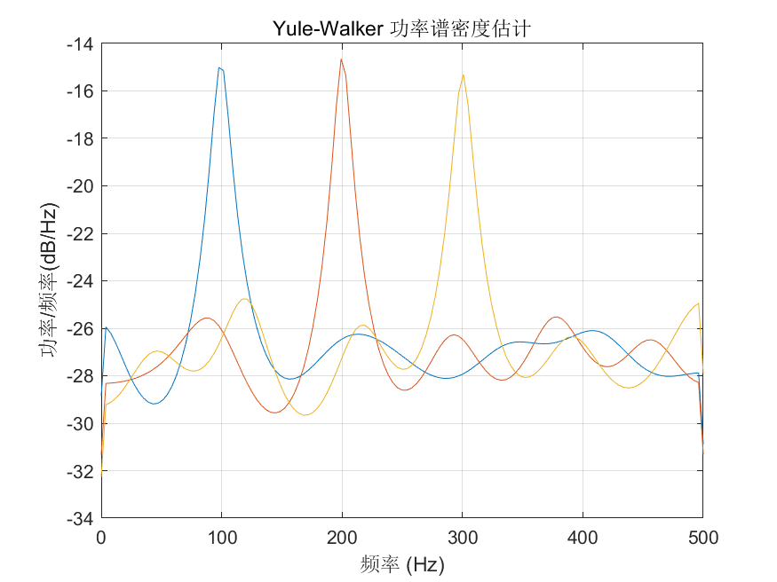

# MATLAB | Spectral Analysis Algorithm | Yule-Walker Power Spectral Density Estimation | Include data and plotting code | Directly Useable

1. Basic Definition
The Yule-Walker Power Spectral Density Estimation is a spectral estimation method based on the autoregressive model, which can perform spectral analysis on time-domain signals to obtain the energy distribution at different frequencies of the signal. The Yule-Walker power spectral density estimation has been widely applied in fields such as signal processing, communication, acoustics, etc. Compared with traditional covariance-based spectral estimation methods, it offers better computational efficiency and estimation accuracy. The steps for Yule-Walker power spectral density estimation are as follows:
Given a time-domain signal x(n) of length N.
Perform preprocessing operations such as windowing and FFT on the signal to obtain its frequency domain representation.
Based on the autoregressive model of the signal, establish the Yule-Walker equation group: R(0) + a(1)R(1) + ... + a(p)R(p) = 0, where R(0) is the autocorrelation function of the signal, R(i) is the i-th coefficient of the autocorrelation function of the signal, a(i) is the autoregression coefficient, and p is the order of the autoregression model.
Solving the Yule-Walker equation group to obtain the autoregression coefficients.
Calculate the power spectral density estimation value of the signal based on the autoregression coefficients: P(ω) = σ^2/|A(ω)|^2, where σ^2 is the variance of the signal, and |A(ω)| is the frequency response of the autoregression coefficients. The advantage of Yule-Walker power spectral density estimation is its good computational efficiency and estimation accuracy, and it also has a good estimation effect on nonlinear components such as harmonics in the signal. However, one disadvantage is that this method requires the use of an autoregressive model, so its estimation effect on higher-order harmonics and other higher-order components in the signal may not be as good as other methods.
2. Definition and Outline Effects
The outline effects are as follows:
\n        \n          \n          \n          \n          \n            To view this video please enable JavaScript, and consider upgrading to a\n            web browser that\n            supports HTML5 video\n  

## Images

<!-- PAYMENT_BLOCK -->

## Get this dataset

- Payment link (Stripe): [Buy now](https://buy.stripe.com/3cs8yP7sY87d0vu9AB)
- Payment QR code: 

<!-- /PAYMENT_BLOCK -->
